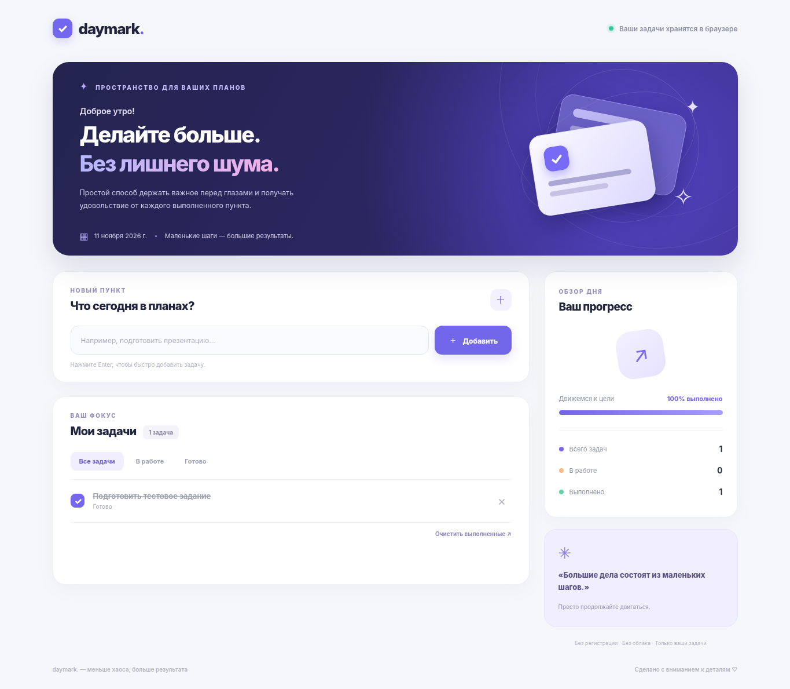
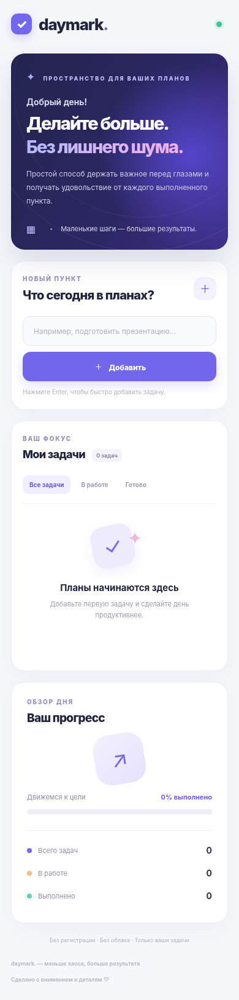

# Daymark — Список задач

Небольшое адаптивное веб-приложение To-Do List для тестового задания на позицию Vibe Coder.

## Функциональность

- Добавление задач с проверкой ввода (до 160 символов).
- Отметка выполненных задач и возврат к активным.
- Удаление отдельных задач и очистка выполненных.
- Автоматическое сохранение в `localStorage`: задачи остаются после обновления страницы.
- Фильтрация: все, активные и выполненные.
- Адаптивный интерфейс и индикация прогресса.
- Управление с клавиатуры, доступные подписи кнопок и уведомления для скринридеров.

## Запуск

Чтобы корректно работали ES-модули, используйте локальный HTTP-сервер.

```bash
npm run dev
```

Открыть **http://127.0.0.1:4173**. Требуется Node.js 18+; устанавливать зависимости не нужно.

## Тесты

```bash
npm test
```

Тестируются операции с задачами, фильтрация, статистика, сериализация/чтение localStorage и обработка повреждённых данных.

## Размещение

- **GitHub Pages**: загрузить файлы в корень GitHub-репозитория → `Settings` → `Pages` → `Deploy from a branch` → `main` / `/ (root)`.
- **Vercel**: импортировать GitHub-репозиторий → Framework Preset `Other` → без build command и без output directory → Deploy.

Внешняя база данных и сервер не нужны. Данные хранятся только в браузере пользователя и не синхронизируются между устройствами.

## AI-инструменты

**ChatGPT (OpenAI, GPT-6)** использовался для подготовки структуры, генерации первичного кода, интерфейсных решений, тестов и проверки требований. Код и сценарии проверяются перед публикацией. Не заявлять, что использовались Cursor или Claude Code, если это не так.

## Технологии

HTML5, CSS3, JavaScript (ES modules), Web Storage API (`localStorage`), Node.js built-in test runner. Без внешних runtime-зависимостей; шрифт Manrope загружается из Google Fonts с системным fallback.

## Скриншоты




